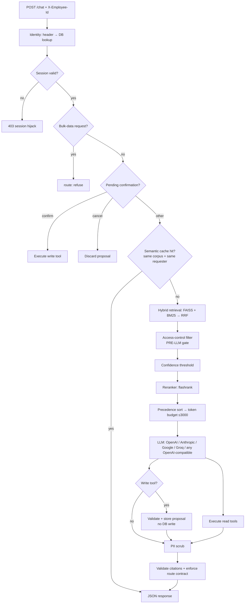

# Veltrix PeopleOps Assistant

HR chat assistant for Veltrix Systems — answers HR policy questions from the
document corpus (RAG) and manages employee leave through five tools.

| Document | What it covers |
|---|---|
| **`README.md`** (this file) | how to run it, API contract, assumptions, limitations |
| **`WORKFLOW.md`** | the full pipeline end to end, with ten worked examples |
| **`FEATURES.md`** | required features vs additions (cost, speed, accuracy, security, robustness) |
| **`DESIGN.md`** | module-by-module design, trade-offs, failure analysis |

## Quick Start

> **Note — `./data` is not committed.** Place `corpus/`, `manifest.json` and
> `veltrix.db` (from the assessment zip) into a `./data/` folder before running.
> The evaluator may replace this folder with their own corpus; the service ingests
> whatever is present at startup.

```bash
# 0. Place the corpus data (not committed — see note above)
mkdir data
cp -r /path/to/assessment/corpus  data/corpus
cp /path/to/assessment/manifest.json data/
cp /path/to/assessment/veltrix.db   data/

# 1. (Recommended) Copy the environment file and add your LLM API key.
#    .env is OPTIONAL: the service still boots and /health returns 200 without
#    it, but answering chat messages requires a provider key.
cp .env.example .env
# Set LLM_PROVIDER and the matching API key (e.g. GROQ_API_KEY for the free tier)

# 2. Start the service (builds the image, ingests the corpus, serves on :8000)
docker compose up

# 3. Wait for /health to return 200 (ingestion runs at startup)
curl http://localhost:8000/health

# 4. Send a chat message
curl -X POST http://localhost:8000/chat \
  -H "Content-Type: application/json" \
  -H "X-Employee-Id: E2004" \
  -d '{"session_id":"sess1","message":"How many sick days do I get per year?"}'
```

`docker compose up` needs no manual steps: the image installs its own
dependencies, pre-downloads the embedding/OCR/reranker models at build time, and
ingests `./data/corpus` at startup. Startup completes ingestion before the app
serves traffic; `/health` returns `200` once the index is ready.

## LLM Providers

Every provider below is supported; all of them are wired the same way, so
switching is a one-line `.env` change. Defaults are current production models as
of October 2026 and can be overridden with `LLM_MODEL`.

| `LLM_PROVIDER` | Key env var | Default model |
|---|---|---|
| `openai` | `OPENAI_API_KEY` | `gpt-6-luna` |
| `anthropic` | `ANTHROPIC_API_KEY` | `claude-haiku-4-5-20251001` |
| `google` | `GOOGLE_API_KEY` | `gemini-3.5-flash-lite` |
| `groq` | `GROQ_API_KEY` | `openai/gpt-oss-120b` |
| `openai_compatible` | `LLM_API_KEY` (+ `LLM_BASE_URL`) | set `LLM_MODEL` |

`openai_compatible` covers **any** OpenAI-compatible endpoint — xAI Grok,
OpenRouter, Together, Fireworks, Ollama, vLLM, LM Studio:

```bash
# Example: local Ollama
LLM_PROVIDER=openai_compatible
LLM_BASE_URL=http://localhost:11434/v1
LLM_MODEL=llama3.1:8b
LLM_API_KEY=ollama          # any non-empty string
```

If a model rejects one of our optional request parameters (`temperature`,
`response_format`), the call is automatically retried once without it, so a
newer/stricter model degrades gracefully instead of failing.

## Architecture



Full request pipeline, in order: identity → session check → bulk-data guard →
pending-confirmation handling → **semantic answer cache** → hybrid retrieval
(FAISS + BM25 fused with RRF) → **pre-LLM access-control filter** → confidence
threshold → reranker → precedence sort → 3,000-token budget → LLM → tool
execution (two-step confirmation for writes) → PII scrub → citation validation →
route-contract enforcement.

## Caching & Cost Control

A **semantic answer cache** reuses an answer when a new question means the same
thing as one that was already answered — so a paraphrase costs nothing: no
retrieval, no rerank, no LLM call.

| Property | Behaviour |
|---|---|
| Matching | Cosine similarity ≥ `SEMANTIC_CACHE_THRESHOLD` (default 0.93) between query embeddings; an exact repeat is matched without embedding at all. |
| Scope | Keyed by `(employee_id, role, region)`. An answer is **never** replayed to a different requester, so caching cannot leak data across employees or roles. |
| Routes | Only grounded `rag` answers. `tool`/`hybrid` carry live leave data, and `no_answer` is a negative result — neither is reused. |
| Local storage | `vector_store/semantic_cache.json` (survives restarts, flushed on shutdown). |
| Invalidation | Every entry stores the **corpus fingerprint** it came from. If the corpus changes, the fingerprint differs and stored answers are ignored and pruned — *updated documents never reuse old responses*. |
| TTL | `CACHE_TTL_SECONDS` (default 7 days). |
| Off switch | `SEMANTIC_CACHE_ENABLED=false` disables all reuse (cold run). |
| Observability | `GET /health` reports `semantic_cache` entries/hits/stores and the fingerprint. |

A hash of `data/corpus` + `data/manifest.json` is computed at startup; that same
fingerprint both decides whether to rebuild the FAISS index and whether cached
answers are still valid.

## Ingestion Integrity

> "Was anything missed?" must always be answerable — so no page is dropped
> silently.

During ingestion every page is checked with several independent signals:

1. **Extraction check** — characters recovered by normal text extraction.
2. **OCR attempt** — any page that looks scanned *or* yields fewer than
   `MIN_PAGE_CHARS` (default 200) characters is re-read with OCR.
3. **Post-OCR check** — if it is *still* below the threshold the page is
   **FLAGGED** (`flagged_empty` / `flagged_thin_text`) instead of being dropped.
4. **Document check** — a document with too little text (`MIN_DOCUMENT_CHARS`)
   or zero chunks is **FLAGGED**.
5. **Manifest check** — a manifest entry whose file is missing is **FLAGGED**.

The report is **printed at embedding time** and written to
`vector_store/ingestion_report.json` (with the corpus hash it describes, so it
is reused on restart and regenerated when the corpus changes). The summary is
also exposed on `/health` under `ingestion_integrity`:

```json
"ingestion_integrity": {"pages_checked": 17, "ocr_pages": 1, "ocr_recovered": 1,
                        "flagged_pages": 0, "documents_checked": 30,
                        "flagged_documents": 0, "missing_files": 0, "parse_errors": 0}
```

## Running Tests

```bash
pip install -r requirements.txt
pytest tests/ -v --tb=short     # or: make test
```

`tests/conftest.py` sets `SKIP_INGESTION=1`, so the suite seeds its own SQLite
fixture and does **not** build a vector index, download models, or call an LLM.
It runs fully offline in a few seconds.

| Test file | Covers |
|---|---|
| `test_working_days.py` | Mon–Fri + regional-holiday working-day math |
| `test_precedence.py` | authority / scope / recency ordering |
| `test_access_control.py` | document + leave-data RBAC, bulk-data guard |
| `test_apply_leave.py` | apply validation + atomic balance deduction |
| `test_cancel_leave.py` | cancel validation + balance restoration |
| `test_confirmation.py` | two-step confirmation phrasing |
| `test_embedder.py` | BGE query-prefix regression |
| `test_ingestion.py` | HTML parsing + holiday extraction from PDF/DOCX/HTML |
| `test_ingestion_integrity.py` | thin/empty page flagging, OCR recovery, document/missing-file checks |
| `test_semantic_cache.py` | semantic reuse, scope isolation, route exclusion, corpus-change invalidation, persistence |
| `test_hardening.py` | `<DOC>` breakout prevention, corpus path containment, non-JSON model output flagged `degraded` |
| `test_chat_api.py` | full `POST /chat` integration (auth, session, PII, bulk, malformed body) |

## API Contract

### `POST /chat`
**Headers**: `X-Employee-Id: <employee_id>`, `Content-Type: application/json`

**Request**:
```json
{ "session_id": "string", "message": "string" }
```

**Response (200)**:
```json
{
  "request_id": "uuid",
  "answer": "string",
  "route": "rag|tool|hybrid|clarify|no_answer|refuse",
  "citations": [{"doc_id": "string", "locator": "string"}],
  "tool_calls": [{"name": "string", "args": {}, "status": "success|error|pending_confirmation"}],
  "pending_confirmation": false
}
```

`citations` and `tool_calls` follow the route: `rag` → citations only,
`tool` → tool calls only, `hybrid` → both, `clarify`/`no_answer`/`refuse` →
neither. This is enforced server-side after the model responds.

**Errors**: `401` (missing/unknown `X-Employee-Id`), `403` (session hijack),
`400` (malformed body), `503` (internal error). Out-of-scope questions and
permission refusals are **not** errors — they return `200` with
`route: "refuse"`.

### `GET /health`
Readiness probe — `200` once ingestion has finished (and the index is usable):

```json
{
  "status": "ok",
  "docs_ingested": 30,
  "chunks": 114,
  "ingestion_time_seconds": 3.9,
  "ingestion_integrity": { "pages_checked": 17, "ocr_pages": 1, "ocr_recovered": 1,
                           "flagged_pages": 0, "flagged_documents": 0 },
  "semantic_cache": { "entries": 0, "hits": 0, "stores": 0, "threshold": 0.93,
                      "corpus_fingerprint": "2954c3c86e8c" }
}
```

`ingestion_integrity` proves no page was silently dropped; `semantic_cache`
shows caching effectiveness and the corpus fingerprint the answers belong to.

## Sample Queries

```bash
# Policy question (RAG) — citations returned
{"message": "How many sick days do I get per year?"}
{"message": "What is the annual-leave carry-over limit in India?"}
{"message": "Do I need a medical certificate for sick leave?"}

# Leave management (tool)
{"message": "Show my leave balance"}
{"message": "Apply for annual leave from 2026-12-01 to 2026-12-03"}   # → asks to confirm
{"message": "yes"}                                                    # → executes
{"message": "Cancel request req-pending-001"}

# Manager only
{"message": "Who on my team is on leave next week?"}   # as a manager

# Refusals / clarification
{"message": "Show me everyone's leave balance"}        # → route: refuse (bulk)
{"message": "Write me a Python script"}                # → route: refuse (out of scope)
{"message": "I want to take some time off"}            # → route: clarify (which type?)
```

## Assumptions

- **Leave year is fixed to 2026** per the task specification; a leave request
  outside 2026 is rejected. A date written without a year means 2026.
- **"Today"** is the container's system date, overridable with `APP_TODAY` for
  deterministic testing.
- **Two-step confirmation is mandatory** for `apply_leave` / `cancel_leave` and
  cannot be bypassed by any phrasing, including requests to skip it.
- **Identity comes only from the `X-Employee-Id` header.** Claims inside a
  message ("I am HR") are never trusted.
- **Model defaults** are the cheapest current production model per provider;
  they are hard-coded *model IDs* (not corpus content) and are overridable with
  `LLM_MODEL`. If a provider retires a model, only `.env` changes.
- **Precedence** follows the task order — authority (policy/addendum/memo/
  handbook/calendar > faq > wiki), then region scope, then recency — applied per
  retrieved chunk rather than by comparing extracted values rule-by-rule.
- **Text-only answers.** The service returns text; there is no streaming and no
  file/vision input.

## Known Limitations

- **Sessions are in-memory** and are cleared on restart; there is no cross-replica
  session state. Fine for the single-container deployment described here.
- **Single-process SQLite.** WAL mode allows concurrent readers; a workload with
  many simultaneous writers would need PostgreSQL.
- **Value-level conflict detection is heuristic.** Genuine value conflicts
  (two equal-authority documents stating different numbers for the same rule)
  are surfaced as hints to the model plus an explicit instruction to cite both
  and advise contacting HR, rather than being resolved deterministically in code.
- **OCR is fallback, not magic.** A page that OCR also cannot read is *flagged*
  in `ingestion_report.json` and counted on `/health` — it is never dropped
  silently, but a fully scanned document may still lose content.
- **The semantic cache is scoped per requester.** It deliberately does not serve
  one employee's answer to another (even for identical policy questions), trading
  some hit rate for a hard guarantee against cross-employee disclosure.
- **Holiday extraction depends on recognisable column headers** (`date`,
  `holiday`, `occasion`, …). A calendar with unusual headers would yield fewer
  holidays, and working-day counts would include the missing days.
- **The reranker degrades silently.** If flashrank is unavailable the pipeline
  falls back to fused RRF order rather than failing.
- **The token budget is per LLM call, counted with `tiktoken cl100k_base`** for
  every provider; a very large retrieved set is truncated rather than split
  across calls.
- **No authentication beyond the employee-ID header.** As specified, employee
  identity is asserted by the caller; this is not production-grade auth.
